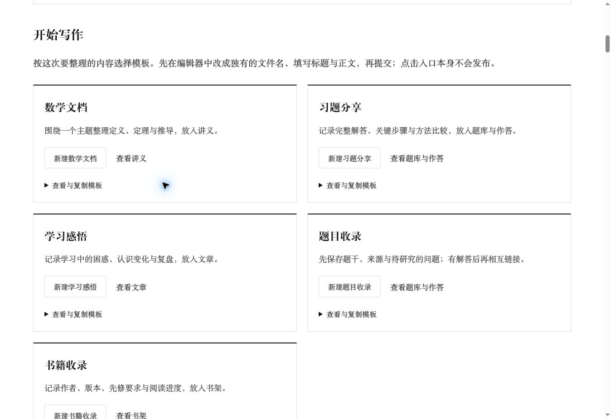

# 网站内容起步流程：本轮验收

日期：2026-10-25。基于 `131441a` 的现有站点，补充管理页五类写作模板及内容归属说明。

## 实现范围

- 管理资料顶部新增“开始写作”页内入口。
- 五种模板分别映射到讲义、题库与作答、文章和书架；题目与解答通过不同标签区分。
- 模板可展开查看、选择复制，或预填到 GitHub 新建文件编辑器。点击入口不执行保存或发布。
- 模板保存在程序模块中，不向 `content/` 添加示例文章。
- 原首页、栏目、字体、公式排版器与 PDF 文件未修改。

## 已执行验证

| 检查 | 结果 |
| --- | --- |
| `npm run check` | 通过 |
| 完整测试 | 58 项通过，0 失败 |
| `node --import tsx scripts/build.tsx` | 通过，生成 381 页、281 个公开资料条目 |
| `npm run verify` | 381 个 HTML 页面、23,037 个本地链接／资源通过 |
| 模板链接 | 五种 UTF-8 模板与文件名完整编码；指向本仓库对应目录 |
| 内容导入 | 使用实际内容加载器导入五种模板，归属及标签正确 |
| 桌面浏览器 | 首页可达管理页；“开始写作”锚点与模板展开正常 |
| 响应式浏览器 | 390px、1440px iframe 中检查真实页面；扣除滚动条后文档宽度为 375px、1425px，均与 scrollWidth 相等 |
| 手机展开模板 | 展开后正文宽度仍为 375px，没有页面整体横向溢出 |
| 无 JavaScript 结构 | 使用原生链接与 details/summary；服务器输出包含完整模板，不依赖前端脚本生成 |
| React 组件复核 | 稳定列表 key、语义标题、可聚焦模板区域、无新增客户端依赖 |

本地环境限制了 tsx CLI 使用的 Unix IPC socket，`npm test` 的 CLI 启动会报 EPERM，因此使用与仓库 CI 相同的 `node --import tsx --test scripts/*.test.ts` 执行全部测试；构建同样通过 Node 的 tsx loader 运行。未修改依赖、脚本或安全设置。

浏览器验证在独立本地预览中完成。未登录 GitHub 提交模板、未上传测试文件、未变更正式站点；PDF 字节保留由现有回归测试及源码差异验证，本轮未逐份人工打开所有 PDF。全站链接检查仅验证本地目标，不声称外部网页始终可用。

界面截图：

## 下一阶段

在使用者认可模板后，为真实材料补齐来源、主题与关联链接，优先改善已有文章，不重复生成基础网站。合并到 main 后由已有发布流程重新校验并部署。
